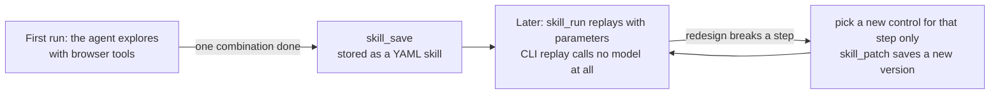
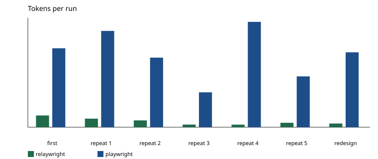

# relaywright

[中文](README.md)

**The first time an agent does a browser task, the pitfalls it works through are saved as a skill file. Later runs call that skill instead of having the model read the page and trial-and-error from scratch.**

Existing browser MCP servers (Playwright MCP, Chrome DevTools MCP, and others) make the model read the page and decide every step on every run, so a repeated task burns tokens again and again and still gives unstable results. relaywright lets the agent explore once:



1. **Explore once.** The agent uses the browser tools to finish one combination of parameters, for example one term's timetable.
2. **Save it as a skill.** `skill_save` writes the steps, several locators per control, and the outcome checks into YAML. Personal data is replaced with placeholders.
3. **Replay.** `skill_run` handles the remaining combinations. Over MCP the agent makes only a few tool calls; from the CLI or a scheduled job no model is called at all.
4. **Fix only the broken step.** When a redesign breaks a step, `skill_run` returns a heal block. The model picks a new control for that step alone, and `skill_patch` saves it as a new version; the other steps stay as they are.

## Results

The same model, the same task, and the same Chrome drive relaywright and Playwright MCP. The task exports portrait timetable PDFs for the three scheduled terms on a mock university portal and names the empty term. relaywright keeps its skills across runs. Playwright MCP starts a fresh session every run.

| tool | first tokens | median repeat | redesign tokens | total | success |
| --- | ---: | ---: | ---: | ---: | ---: |
| relaywright | 144,690 | 54,720 | 45,472 | 498,938 | 5/7 |
| Playwright MCP 0.0.83 | 973,960 | 858,912 | 924,268 | 6,304,405 | 5/7 |

- The median repeat uses about **one sixteenth** of Playwright MCP's tokens, the redesign run about **one twentieth**, and the total about one thirteenth.
- Even the first exploration uses about one seventh, because snapshots are compact and an action returns only what changed.
- The median repeat takes about 36 seconds, against about 142 seconds for Playwright MCP.



The setup, the failures, and how to reproduce are under [Benchmark](#benchmark). Per-run data is in [docs/bench/summary.md](docs/bench/summary.md).

## What a skill looks like

A skill is YAML you can read, edit, and commit. This excerpt is from [examples/zf-timetable/skill.yaml](examples/zf-timetable/skill.yaml):

```yaml
name: zf-timetable
description: 导出指定学年学期的个人课表 PDF
params:
  year: { type: string, example: 2025-2026 }
  term: { type: string, example: "1" }
steps:
  - id: s1-select-学年
    select:
      target: { role: combobox, name: 学年, css: "#xnm" }
      value: "{{year}}"
  # ... select the term, click 查询 (search) ...
  - id: s4-expect
    expect:
      any:
        - outcome: empty
          when: { text_present: 该学年学期尚无您的课表 }
          message: "{{year}} 第 {{term}} 学期尚未排课"
        - outcome: ok
          when: { text_present: "{{year}}学年第{{term}}学期", table_rows_min: 1 }
  # ... click 输出PDF (export PDF) and save as {{year}}-{{term}}.pdf
```

- Each control records its role, name, CSS, and text. After a small page change, another locator can still find it.
- `expect` turns a business result such as "no timetable" into `empty` and reports it, instead of treating the page as broken.
- Saving removes personal data: your own values become tokens such as `‹我.姓名›`, and other people's values become parameters.

One skill can run over a parameter matrix:

```bash
npx relaywright skill run zf-timetable --matrix year=2025-2026,2026-2027 --matrix term=1,2
```

## Login and security

Repeated tasks often stop at a login. relaywright hands that step to a person and keeps credentials away from the model:

- **Handoff to a person.** On a login or captcha, the page is hidden from the model and typing into a password field is refused. The browser comes to the front with a notification; the person at this computer finishes, and the task continues.
- **Credentials stay out of the model.** Passwords and cookies never appear in a tool result. The login state is kept encrypted by the browser itself.
- **Domain allowlist.** Navigation outside the list is blocked before the request is sent, and only the local dialog can allow a domain. `browser_eval` is off unless you enable it.
- **Audit.** The audit log lives in `~/.relaywright/audit/`. `relaywright audit verify` checks the hash chain.

## Quick start

Node.js 22 or newer, and a local Chrome or Edge. With no system browser, `npx relaywright browser install` downloads Chrome for Testing into `~/.relaywright/browsers`.

```bash
npm install
npm run build
npx relaywright init                     # browser mode, allowlist, and so on; Enter keeps the current value
npx relaywright init --write-mcp cursor  # writes the MCP launch command into .cursor/mcp.json here
```

With `--yes`, or with no terminal, `init` writes only what the flags say and does not ask. Your name and account are stored only on this machine and are not echoed.

### Cursor

Once `.cursor/mcp.json` is written, the agent follows the flow in the MCP instructions: call `skill_list` first and `skill_run` when a skill fits; otherwise do one combination with the browser tools, `skill_save` it, and `skill_run` the rest. Run `npm run build` again after changing the source.

### CLI

MCP and the CLI share one daemon and one browser, so a skill explored in Cursor can be replayed from a terminal right away.

```bash
npx relaywright daemon start
npx relaywright open https://example.com
npx relaywright snapshot
npx relaywright act click e3
npx relaywright skill list
npx relaywright daemon stop          # leaves the browser and its login; --close-browser closes it too
```

Set `RELAYWRIGHT_HEADLESS=1` for headless mode.

### DeepSeek Harness

Add the plugin `github:JiangnanZhang-2006/relaywright` (the `github:` prefix has to be typed), then restart. The repository includes the compiled `dist/`, so installation does not build. Tool names are prefixed with `mcp__relaywright__`. Browser mode and the allowlist still come from `relaywright init`.

## Benchmark

```bash
npm run bench -- --tools relaywright,playwright --repeats 5 --out bench/results
```

The API key is read from `DEEPSEEK_API_KEY` and is not written into the results. `--thinking on` (the default) enables DeepSeek thinking mode. Success comes from the export requests the page server received, not from the model's own report: one portrait PDF for each of the three scheduled terms, none for the empty term, and a final answer that names the empty term.

The numbers above come from one full run on 2026-10-29 (`deepseek-chat`, served as `deepseek-flash`, thinking on, Chrome 156, seven runs per tool). Both of relaywright's failures exported the 2025-2026 first term twice. Of Playwright MCP's two failures, one exported only the first term through the page (the other terms were requested by a script, which does not count), and one exported the second term twice.

## Development

```bash
npm run typecheck
npm test
npm run test:e2e
npm run licenses
```

Unit tests need no browser. `test:e2e` drives the fixture pages under `fixtures/` for about four minutes, using a temporary `RELAYWRIGHT_HOME`, so it does not touch your own browser profile.

See [docs/architecture.md](docs/architecture.md) for the design, and [CONTRIBUTING.md](CONTRIBUTING.md), [SECURITY.md](SECURITY.md), [CHANGELOG.md](CHANGELOG.md), and [ROADMAP.md](ROADMAP.md). The project is at 0.1.0-rc.1.

## License

[Apache-2.0](LICENSE). `npm run licenses` checks the lockfile against an allowlist: distributed dependencies must be permissive, and dev dependencies may also be MPL-2.0.
