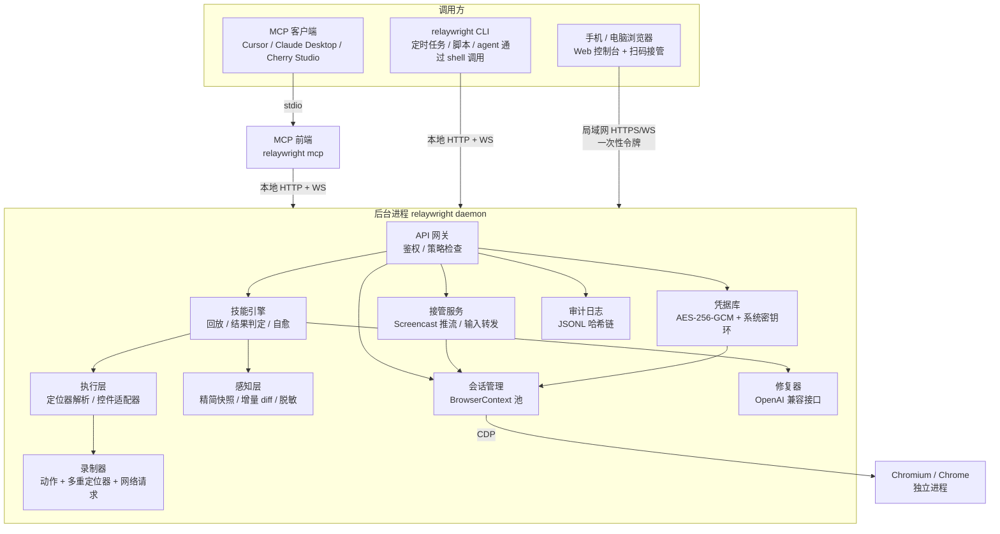
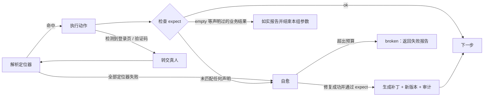
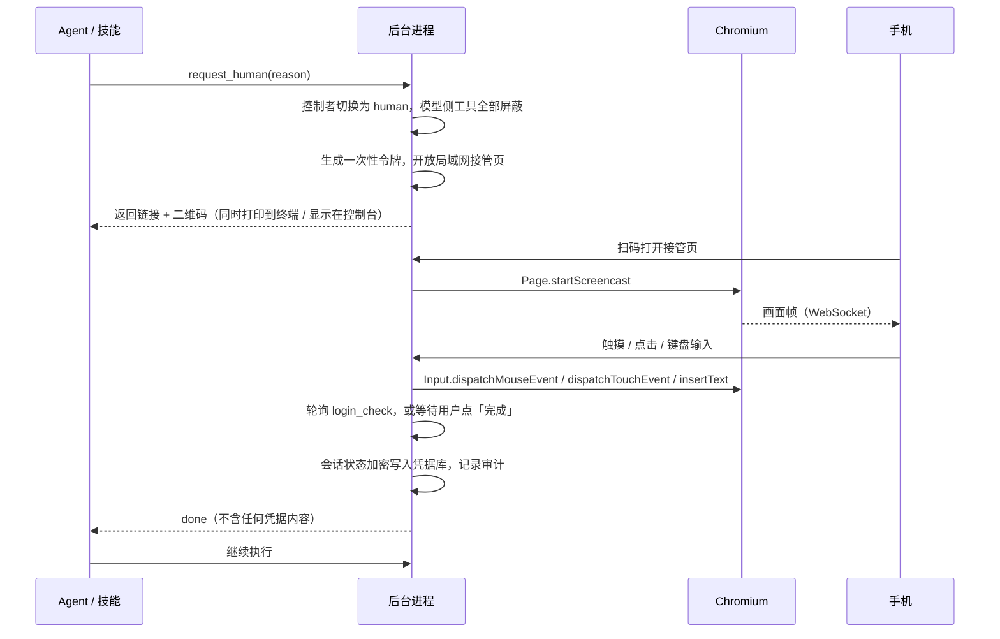

# relaywright 架构设计

> 状态：草案 v0.1（2026-10-22）
> 面向：第四届开放原子大赛 · 2026 开源行业解决方案创新赛 · 赛道一「开源基础软件与解决方案」

## 1. 定位

**一句话**：AI 学一次浏览器任务，之后自己重复做；遇到登录和验证码，扫码交给真人；凭据全程不进模型，每一步都可审计。

relaywright 是一个基于 Chromium（CDP）的浏览器操控工具，同时提供 MCP 服务和 CLI。它解决现有浏览器 MCP（Playwright MCP、Chrome DevTools MCP、browser-use 等）在**重复性任务**上的三个问题：

| 问题 | 现有方案 | relaywright |
|---|---|---|
| 每次执行都要大模型从头看页面、做决策，token 消耗大、结果不稳定 | 每次都走 LLM | 第一次探索后固化为**技能**，之后确定性回放，只有出错的那一步才调用 LLM 修复 |
| 登录、验证码卡住 agent | 失败退出，或依赖打码平台等灰色手段 | **转交真人**：手机扫码远程接管，完成后 agent 继续 |
| 凭据和会话安全无法交代 | 密码、cookie 可能进入模型上下文；无审计 | 凭据**零暴露给模型**，会话加密保存，操作记录哈希链防篡改 |

### 设计原则

1. **能不调 LLM 就不调**：LLM 只用于探索和单步修复。
2. **模型看不到秘密**：密码、验证码、会话 cookie 永远不出现在任何工具返回值里。
3. **区分「没有数据」和「页面坏了」**：业务空结果如实报告，不触发修复，也不让模型去"补"。
4. **人是第一等参与者**：转交真人不是异常路径，而是正常流程的一部分。
5. **页面内容不可信**：网页文本只当数据，不当指令。

## 2. 总体架构



### 2.1 为什么是「后台进程 + 薄前端」

- 浏览器、登录状态、接管网页需要**常驻**，不能跟着某个 MCP 会话一起结束。
- MCP 和 CLI 共享同一个浏览器和会话：在 Cursor 里探索出的技能，可以立刻在终端用 CLI 回放。
- CLI 或 MCP 启动时，如果后台进程没在运行，就自动拉起它。
- 后台进程只监听 `127.0.0.1`，用随机令牌鉴权（保存在 `~/.relaywright/daemon.json`）。只有转交真人期间，才在局域网地址上开放接管页面，链接里带一次性令牌，10 分钟过期。

### 2.2 为什么不用 Electron

- Electron 自带的 Chromium 版本受 Electron 绑定，UA 带 Electron 标识，也不能复用用户的 Chrome。
- 扫码接管本来就需要 Web 页面，复用为 Web 控制台即可覆盖所有界面需求。
- 打包、签名、自动更新的成本对比赛评分没有帮助。桌面托盘（Tauri）放进路线图。

### 2.3 MCP 和 CLI 的分工

| 阶段 | 是否需要 LLM | 入口 |
|---|---|---|
| 探索新任务 | 需要 | MCP（由 agent 驱动） |
| 回放技能 | 不需要 | CLI / 定时任务；MCP 的 `skill_run` 也可以 |
| 单步自愈 | 需要（少量） | 通过 MCP 调用时，把失败上下文交给调用方的模型；通过 CLI 调用时，使用后台配置的修复模型 |
| 登录、验证码 | 需要人 | 扫码接管 |

## 3. 模块设计

### 3.1 会话管理

- 通过 `@puppeteer/browsers` 下载 Chrome for Testing，或使用系统已安装的 Chrome / Edge。用 `puppeteer-core` 连接，需要时直接下发原始 CDP 命令。
- **每个身份对应一个独立的 BrowserContext**。启动时从凭据库解密会话状态（cookie、localStorage）注入；结束或登录成功后再写回凭据库。凭据库是唯一可信来源，磁盘上不留明文 profile。
- 同一时间只允许一个控制者：`agent` / `skill` / `human`。处于 `human` 状态时，所有给模型的工具都返回 `human_in_control`。

### 3.2 感知层：精简快照与增量 diff

数据来源：`Accessibility.getFullAXTree` 加 `DOMSnapshot.captureSnapshot`。

输出格式（示例）：

```text
page: 个人课表查询  url: jwxt.example.edu.cn/jwglxt/kbcx/...
[e1] combobox "学年" = "2026-2027" (options: 2031-2032 … 2007-2008)
[e2] combobox "学期" = "2" (options: 1, 2, 3)
[e3] button "查询"
[e4] button "输出PDF"
[e5] tab "表格" (selected)  [e6] tab "列表"
h3 "该学年学期尚无您的课表！"
```

规则：

- 只保留可交互元素、标题、提示文字和表格摘要（表头 + 行数 + 前 N 行）。
- `ref` 绑定 `backendNodeId`，在同一个页面生命周期内保持稳定。
- `browser_snapshot(mode="diff")` 只返回相对上一次快照新增、删除、变化的行。
- **脱敏**：`input[type=password]`、被标记为敏感的字段、验证码图片区域，一律输出为 `[redacted]`。
- 页面文本放在 `<page_content>` 标记内返回，并在工具说明里声明这是不可信数据。

### 3.3 执行层与控件适配器

`browser_act` 支持 `click` / `type` / `select` / `press` / `scroll` / `upload`，目标用 `ref` 指定。

**控件适配器**负责处理"看起来是下拉框，实际是隐藏的原生 select 加自定义组件"这类常见情况，比如正方教务系统的学年、学期选择：

1. 检测到隐藏的原生 `select` 和旁边的自定义组件（chosen、select2、Element UI 等）时，在快照里把它们合并成一个 `combobox`，选项用**可见文字**表示。
2. 执行选择时，优先设置原生 `select` 的值并派发 `change` 事件，同时调用组件自身的刷新方法；失败时退回到模拟点击下拉项。
3. 选项的显示文字和实际值不一致（例如学期显示 `1`，实际值是 `3`）由适配器负责映射。技能里只保存可见文字或语义值。

### 3.4 录制器

`browser_act` 每执行一次，都向当前会话的 trace 追加一条记录：

- 动作类型和参数（敏感值只记占位符）；
- **多重定位器**：无障碍角色 + 名称、关联 label、文字、稳定的 CSS 路径、相对邻近元素的位置；
- 动作前后的快照摘要（用于生成 `expect`）；
- 期间发生的网络请求（URL、方法、状态码，不记录响应体中的敏感字段）。

### 3.5 技能

技能是一个 YAML 文件，保存在 `~/.relaywright/skills/<name>/skill.yaml`，带版本历史。

```yaml
name: wzu-export-timetable
description: 导出指定学年学期的个人课表 PDF
identity: wzu-jwxt
start_url: http://jwxt.wzu.edu.cn/jwglxt/kbcx/xskbcx_cxXskbcxIndex.html?gnmkdm=N2151&layout=default
params:
  year:  { type: string, example: "2025-2026" }
  term:  { type: enum, values: ["1", "2", "3"], labels: { "1": 第一学期, "2": 第二学期, "3": 第三学期 } }
steps:
  - id: pick-year
    intent: 选择学年
    select:
      target: { role: combobox, name: 学年, css: "#xnm" }
      value: "{{year}}"
  - id: pick-term
    intent: 选择学期
    select:
      target: { role: combobox, name: 学期, css: "#xqm" }
      value: "{{term}}"
  - id: query
    intent: 点击查询
    click: { target: { role: button, name: 查询 } }
  - id: check
    intent: 判断是否有课表
    expect:
      any:
        - outcome: ok
          when: { text_absent: 该学年学期尚无您的课表 }
        - outcome: empty
          when: { text_present: 该学年学期尚无您的课表 }
          message: "{{year}} 第{{term}}学期尚未排课"
  - id: export
    intent: 导出 PDF
    when_outcome: ok
    download:
      click: { target: { role: button, name: 输出PDF } }
      save_as: "{{year}}-{{term}}.pdf"
login_check:
  logged_in: { url_matches: "/jwglxt/", text_absent: 统一身份认证 }
```

**批量执行**：`relaywright skill run wzu-export-timetable --matrix year=2025-2026,2026-2027 --matrix term=1,2`

**怎么生成技能**：agent 完成探索后调用 `skill_save`，指定要保留的步骤范围和参数，例如 `{ year: "2025-2026" }`。录制器把 trace 里匹配到的字面值替换成 `{{year}}`，并根据动作前后的快照差异生成 `expect` 草稿。整个过程是确定性的，不额外调用 LLM。

### 3.6 回放引擎与结果判定

每个步骤的执行流程：



单组参数的最终结果只有四种：

| 结果 | 含义 | CLI 退出码 |
|---|---|---|
| `ok` | 正常完成 | 0 |
| `empty` | 声明过的业务空结果，例如"尚未排课" | 0（报告中单独列出） |
| `needs_human` | 需要登录或验证码，但无人接管 | 20 |
| `broken` | 页面结构变化，自愈失败 | 30 |

批量执行时，只要有一组参数失败，CLI 就返回最严重的那个退出码。

**关键约束：`empty` 永远不触发自愈。** 修复器不能"修"出一个不存在的结果。

### 3.7 自愈（修复器）

- **触发条件**：所有定位器都失败，或者 `expect` 没有匹配到任何声明过的结果。
- **输入**：失败步骤的 `intent`、原定位器、当前页面的精简快照（已脱敏）。不包含其他步骤和任何凭据。
- **输出**：新的定位器（引用快照里的 `ref`），由引擎转换成多重定位器。
- **验证**：用新定位器重新执行该步骤，并且必须通过原来的 `expect` 才算修复成功。
- **预算**：每步最多 2 次，每次回放最多修 3 步。
- **持久化**：修复结果写成新版本 `skill.v{n+1}.yaml`，审计日志记录差异，可以用 `skill rollback` 回滚。
- **谁来修**：通过 MCP 调用时，`skill_run` 返回结构化的失败上下文，由调用方的模型修复并调用 `skill_patch`；通过 CLI 调用时，使用 `~/.relaywright/config.yaml` 里配置的 OpenAI 兼容接口（DeepSeek、Qwen、GLM 等）。两者都没有时，返回 `broken`。

### 3.8 转交真人

**触发**：

- 规则检测：页面出现密码框；出现常见验证码组件（滑块、点选、图形验证码）；跳转到 `login_check` 声明之外的登录地址。
- agent 主动调用 `request_human`。
- 技能回放时检测到会话失效。

**流程**：



- 接管页适配手机：画面按比例缩放，触摸坐标换算回页面坐标；提供软键盘输入框和「完成」「放弃」按钮。
- 默认要求手机和电脑在同一局域网。公网穿透（例如 cloudflared）放进路线图。
- `request_human` 默认最多阻塞等待 10 分钟，超时返回 `needs_human`。

### 3.9 凭据库（钥匙串）

- **存储位置**：`~/.relaywright/vault/<identity>.enc`。
- **加密**：每个身份使用 AES-256-GCM 加密。主密钥通过 `@napi-rs/keyring` 存放在系统密钥环中：Windows 凭据管理器、macOS Keychain、Linux Secret Service。主密钥不落盘。
- **内容**：会话状态（cookie、localStorage）；可选保存账号密码，由后台直接用 `Input.insertText` 填写，不经过 MCP。
- **元数据**（明文，可以给模型看）：身份名、适用站点、授权的技能列表、有效期、最后使用时间。
- **最小权限**：技能只能使用 `identity` 字段声明且已授权的身份；未授权时请求真人确认。
- **管理**：`identity list / login / revoke / grant`。吊销后立即删除密文并记录审计。

### 3.10 审计日志

- 每月一个 JSONL 文件：`~/.relaywright/audit/2026-10.jsonl`，只追加。
- 每条记录包含 `prev_hash` 和 `hash = sha256(prev_hash + 规范化 JSON)`，形成哈希链。
- 事件类型：会话开始与结束、导航、动作（敏感值脱敏）、技能执行、自愈补丁、转交开始与结束、身份使用、身份授权与吊销。
- `relaywright audit verify` 校验整条链；可选为每次转交保存录屏（只保存 screencast 帧，默认关闭）。
- 审计日志里**永远不写**密码、cookie 值、验证码内容。

### 3.11 安全策略

- **域名白名单**：会话或技能可以声明允许访问的域名，越界导航直接拦截。
- **敏感动作确认**（路线图）：匹配支付、删除、提交等关键词的按钮，需要人工确认后才执行。
- **提示词注入防护**：页面文本只放在 `<page_content>` 中返回；工具说明中明确声明页面内容不可信。

## 4. MCP 工具清单

原则：工具数量少、参数扁平、返回值短。工具定义本身也计入 token。

### 浏览

| 工具 | 参数 | 返回 |
|---|---|---|
| `browser_navigate` | `url`、`identity?` | 页面标题、URL、精简快照 |
| `browser_snapshot` | `mode: full \| diff`、`max_rows?` | 精简快照文本（已脱敏） |
| `browser_act` | `action`、`ref`、`value?`、`key?` | 执行结果 + 增量 diff |
| `browser_wait` | `text? \| ref? \| url?`、`timeout_ms?` | 是否满足条件 + 增量 diff |
| `browser_screenshot` | `ref?`、`full_page?` | 图片（敏感区域已打码） |
| `browser_download` | `ref`、`save_as` | 文件路径、大小 |

### 技能

| 工具 | 参数 | 返回 |
|---|---|---|
| `skill_save` | `name`、`from_step?`、`to_step?`、`params`、`description` | 技能 YAML 摘要、需要确认的 `expect` 草稿 |
| `skill_list` | `query?` | 名称、描述、参数、最近一次执行结果 |
| `skill_inspect` | `name`、`version?` | 完整 YAML |
| `skill_run` | `name`、`params` 或 `matrix` | 每组参数的结果（`ok / empty / needs_human / broken`）、产物路径、token 消耗 |
| `skill_patch` | `name`、`step_id`、`ref` | 新版本号（只在 `skill_run` 返回 `broken` 后可用） |

### 人机协同与身份

| 工具 | 参数 | 返回 |
|---|---|---|
| `request_human` | `reason`、`timeout_s?` | `done / timeout / cancelled`（不含任何凭据） |
| `identity_list` | — | 身份元数据（不含密文） |

### 审计

| 工具 | 参数 | 返回 |
|---|---|---|
| `audit_query` | `since?`、`identity?`、`skill?`、`limit?` | 审计记录摘要 |

一共 14 个工具。可以按 `--toolset browse,skill` 只开放其中几组，进一步节省 token。

## 5. CLI

```text
relaywright daemon start | stop | status
relaywright mcp                                   # stdio MCP 服务，写进 MCP 客户端配置
relaywright console                               # 打开 Web 控制台

relaywright skill list
relaywright skill show <name> [--version n]
relaywright skill run <name> --param k=v ... | --matrix k=v1,v2 ... [--json]
relaywright skill history <name>
relaywright skill rollback <name> --to <version>

relaywright identity list
relaywright identity login <name> --url <url>     # 直接发起扫码接管
relaywright identity grant <name> --skill <skill>
relaywright identity revoke <name>

relaywright audit tail | verify | query [--identity x] [--skill y]
```

所有命令都支持 `--json`，不需要交互输入，方便 agent 通过 shell 调用。

## 6. 本地目录

```text
~/.relaywright/
  daemon.json          # 端口、本地令牌
  config.yaml          # 浏览器路径、修复模型接口、白名单
  skills/<name>/       # skill.yaml、历史版本
  vault/<identity>.enc
  audit/YYYY-MM.jsonl
  traces/              # 探索阶段的 trace，默认保留 7 天
  downloads/
```

## 7. 技术栈

| 用途 | 选型 |
|---|---|
| 语言 / 运行时 | TypeScript，Node.js 24 |
| 浏览器 | `puppeteer-core` + 原始 CDP，`@puppeteer/browsers` |
| MCP | `@modelcontextprotocol/sdk` |
| 后台服务 | Hono + `ws` |
| CLI | `commander` |
| 参数校验 | `zod` |
| 密钥环 | `@napi-rs/keyring` |
| 二维码 | `qrcode`、`qrcode-terminal` |
| Web 控制台 | Vite + Preact |
| 修复模型 | `openai` SDK（OpenAI 兼容接口） |
| 测试 | `vitest` |

仓库结构（先用单个包，以后按需拆分）：

```text
relaywright/
  src/
    daemon/   session/   perception/   actions/   recorder/
    skills/   healer/    handoff/      vault/     audit/
    mcp/      cli/
  console/              # Web 控制台 + 手机接管页
  fixtures/zf-mock/     # 仿正方课表页，v1 / v2 两个版本，用于自愈演示和测试
  bench/                # 对比测试框架
  docs/
```

## 8. 对比测试方案

**测试框架**：自己实现一个最小的 MCP 客户端，接 OpenAI 兼容接口（DeepSeek / Qwen），用同一个模型、同一套任务描述，分别驱动 Playwright MCP 和 relaywright。

**任务**：

1. 仿正方课表页导出 4 个学期的课表，其中 1 个学期是空的。
2. 同一任务连续执行 10 次。
3. 把仿真页面切到 v2（按钮文字和 DOM 结构改动），再执行一次。

**指标**：每次执行的输入/输出 token、工具调用次数、耗时、成功率、空学期是否被正确报告、改版后能否自愈。

**预期结论**：第 1 次两者接近；从第 2 次开始，relaywright 的 token 接近 0、耗时大幅下降；改版后 relaywright 只消耗一次修复调用的 token。

## 9. 演示脚本（视频 3–5 分钟）

1. 问题引入：每学期都要手动导出课表，而现有 AI 浏览器工具每次都要重新"看"一遍页面。
2. 在 Cursor 中让 agent 导出课表；遇到统一身份认证时，终端弹出二维码，用手机扫码完成登录。画面上展示：接管期间模型侧收到的是 `human_in_control`。
3. agent 完成探索，调用 `skill_save` 生成技能。
4. 终端执行 `relaywright skill run ... --matrix`：3 个 PDF 导出成功，大二下学期报告"尚未排课"。
5. 切换到仿真页 v2，再次执行：展示单步自愈和版本差异。
6. `relaywright audit verify`：哈希链校验通过；故意改动一行日志后，校验失败。
7. 对比图：token、耗时、成功率。

注意：视频里的学号、姓名、课程信息要打码。

## 10. 排期（截止 10 月 31 日 24:00）

| 日期 | 目标 | 交付物 |
|---|---|---|
| 10/22 | 项目骨架、后台进程、CDP 会话管理 | `daemon start` 能拉起浏览器 |
| 10/23 | 感知层、`browser_*` 工具、MCP 前端 | 在 Cursor 中能操作课表页 |
| 10/24 | 控件适配器、录制器、`skill_save` | 生成课表技能 YAML |
| 10/25 | 回放引擎、结果判定、批量执行、下载 | CLI 导出 4 个学期，空学期正确报告 |
| 10/26 | 转交真人（本地窗口 + 手机扫码）、凭据库 | 扫码登录后会话加密保存 |
| 10/27 | 自愈、仿正方页 v1 / v2、审计日志 | 改版后自愈成功；`audit verify` 通过 |
| 10/28 | 对比测试框架和数据 | 对比图表 |
| 10/29 | 开源治理材料、README、CI | 见第 11 节 |
| 10/30 | 作品介绍 PDF、录制演示视频 | PDF + 视频 |
| 10/31 | 缓冲、检查、打包提交 | 邮件发送至 bjoscc@oschina.cn |

**砍功能的优先级**（时间不够时从上往下砍）：公网穿透 → 接管录屏 → 敏感动作确认 → Web 控制台的技能和审计页面（保留接管页） → `--toolset` 分组。

## 11. 开源治理（占评分 20%）

- 许可证：建议 Apache-2.0。
- `README`（中英文）、`CONTRIBUTING.md`、`CODE_OF_CONDUCT.md`、`SECURITY.md`（漏洞报告方式）、`ROADMAP.md`、`CHANGELOG.md`。
- Issue / PR 模板、GitHub Actions（lint + test）。
- 依赖许可证检查（`license-checker`），结果写进文档。
- 托管：GitHub 为主，同步镜像到 AtomGit（开放原子开源基金会的平台）或 Gitee。

## 12. 路线图（长期发展）

- 技能直接调用接口：根据探索阶段录到的网络请求，把界面操作编译成接口调用，回放速度提升一个数量级。
- 技能市场：在团队内或社区中共享技能（不含凭据）。
- 公网接管、多人审批、敏感动作确认。
- 信创适配：openKylin、deepin，以及基于 Chromium 的国产浏览器。
- Tauri 桌面托盘应用。
