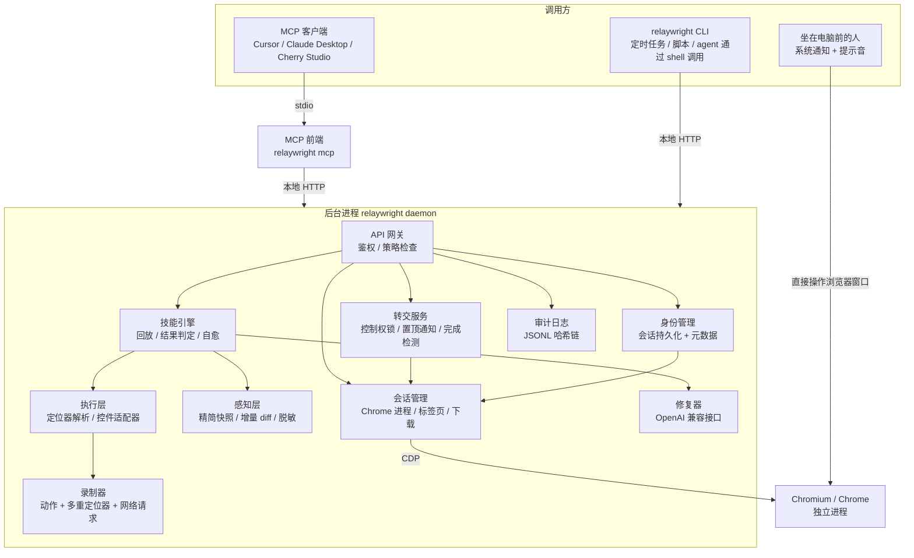
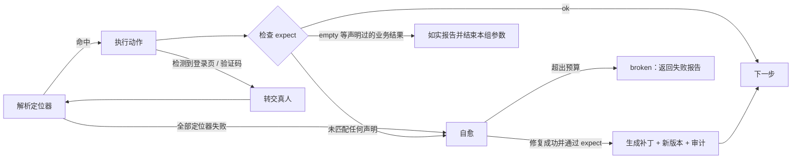
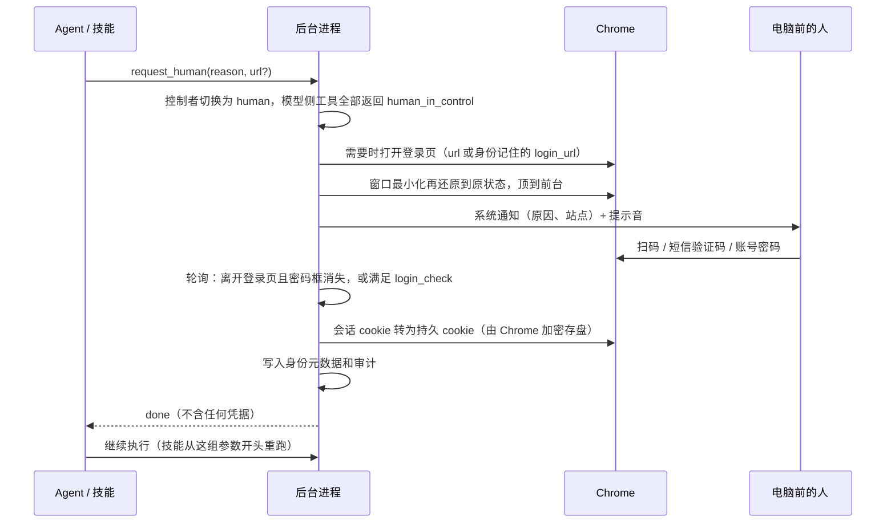

# relaywright 架构设计

> 状态：草案 v0.2（2026-10-25，转交真人改为本机完成，凭据改由浏览器自身加密保存）
> 面向：第四届开放原子大赛 · 2026 开源行业解决方案创新赛 · 赛道一「开源基础软件与解决方案」

## 1. 定位

**一句话**：AI 学一次浏览器任务，之后自己重复做；遇到登录和验证码，把浏览器交给坐在电脑前的人；凭据全程不进模型，每一步都可审计。

relaywright 是一个基于 Chromium（CDP）的浏览器操控工具，同时提供 MCP 服务和 CLI。它解决现有浏览器 MCP（Playwright MCP、Chrome DevTools MCP、browser-use 等）在**重复性任务**上的三个问题：

| 问题 | 现有方案 | relaywright |
|---|---|---|
| 每次执行都要大模型从头看页面、做决策，token 消耗大、结果不稳定 | 每次都走 LLM | 第一次探索后固化为**技能**，之后确定性回放，只有出错的那一步才调用 LLM 修复 |
| 登录、验证码卡住 agent | 失败退出，或依赖打码平台等灰色手段 | **转交真人**：锁住模型、把浏览器顶到前台并通知，人在电脑上扫码或输入密码，登录完成后自动继续 |
| 凭据和会话安全无法交代 | 密码、cookie 可能进入模型上下文；无审计 | 模型**无法输入密码**、看不到 cookie；会话由浏览器借助系统级加密保存，按身份管理；接管和身份操作写入哈希链审计 |

### 设计原则

1. **能不调 LLM 就不调**：LLM 只用于探索和单步修复。
2. **模型看不到秘密**：密码、验证码、会话 cookie 永远不出现在任何工具返回值里。
3. **区分「没有数据」和「页面坏了」**：业务空结果如实报告，不触发修复，也不让模型去"补"。
4. **人是第一等参与者**：转交真人不是异常路径，而是正常流程的一部分。
5. **页面内容不可信**：网页文本只当数据，不当指令。

## 2. 总体架构



### 2.1 为什么是「后台进程 + 薄前端」

- 浏览器和登录状态需要**常驻**，不能跟着某个 MCP 会话一起结束。后台进程重启时不关闭浏览器，新进程重新连上原来的 Chrome，登录状态不受影响。
- MCP 和 CLI 共享同一个浏览器和会话：在 Cursor 里探索出的技能，可以立刻在终端用 CLI 回放。
- CLI 或 MCP 启动时，如果后台进程没在运行，就自动拉起它。
- 后台进程只监听 `127.0.0.1`，用随机令牌鉴权（保存在 `~/.relaywright/daemon.json`），不对局域网开放任何端口。

### 2.2 为什么不用 Electron

- Electron 自带的 Chromium 版本受 Electron 绑定，UA 带 Electron 标识，也不能复用用户的 Chrome。
- 需要人参与时，人直接操作浏览器窗口；提示放在系统通知里，不需要桌面外壳。
- 打包、签名、自动更新的成本对比赛评分没有帮助。桌面托盘（Tauri）放进路线图。

### 2.3 MCP 和 CLI 的分工

| 阶段 | 是否需要 LLM | 入口 |
|---|---|---|
| 探索新任务 | 需要 | MCP（由 agent 驱动） |
| 回放技能 | 不需要 | CLI / 定时任务；MCP 的 `skill_run` 也可以 |
| 单步自愈 | 需要（少量） | 通过 MCP 调用时，把失败上下文交给调用方的模型；通过 CLI 调用时，使用后台配置的修复模型 |
| 登录、验证码 | 需要人 | 转交真人（人在电脑上完成） |

## 3. 模块设计

### 3.1 会话管理

- 通过 `@puppeteer/browsers` 下载 Chrome for Testing，或使用系统已安装的 Chrome / Edge。用 `puppeteer-core` 连接，需要时直接下发原始 CDP 命令。
- 后台进程自己启动 Chrome（独立进程、独立配置目录 `~/.relaywright/profiles/default`、开启调试端口），再用 `puppeteer-core` 连上去。启动时如果发现上次的 Chrome 还在运行，就直接接管它。有界面模式下，后台进程退出或重启都不关闭浏览器；`daemon stop --close-browser` 才关闭。
- 同一时间只允许一个控制者：`agent` / `skill` / `human`。处于 `human` 状态时，所有给模型的工具都返回 `human_in_control`。

### 3.2 感知层：精简快照与增量 diff

数据来源：`Accessibility.getFullAXTree` 加 `DOMSnapshot.captureSnapshot`。

输出格式（示例）：

```text
page: 个人课表查询  url: jwxt.example.edu.cn/jwglxt/kbcx/...
[e1] combobox "学年" = "2026-2027" (options: 2031-2032 … 2007-2008)
[e2] combobox "学期" = "2" (options: 1, 2, 3)
[e3] button "查询"
[e4] button "输出PDF"
[e5] tab "表格" (selected)  [e6] tab "列表"
h3 "该学年学期尚无您的课表！"
```

规则：

- 只保留可交互元素、标题、提示文字和表格摘要（表头 + 行数 + 前 N 行）。
- `ref` 绑定 `backendNodeId`，在同一个页面生命周期内保持稳定。
- `browser_snapshot(mode="diff")` 只返回相对上一次快照新增、删除、变化的行。
- **脱敏**：`input[type=password]`、被标记为敏感的字段、验证码图片区域，一律输出为 `[redacted]`。
- 页面文本放在 `<page_content>` 标记内返回，并在工具说明里声明这是不可信数据。

### 3.3 执行层与控件适配器

`browser_act` 支持 `click` / `type` / `select` / `press` / `scroll` / `upload`，目标用 `ref` 指定。

**控件适配器**负责处理"看起来是下拉框，实际是隐藏的原生 select 加自定义组件"这类常见情况，比如正方教务系统的学年、学期选择：

1. 检测到隐藏的原生 `select` 和旁边的自定义组件（chosen、select2、Element UI 等）时，在快照里把它们合并成一个 `combobox`，选项用**可见文字**表示。
2. 执行选择时，优先设置原生 `select` 的值并派发 `change` 事件，同时调用组件自身的刷新方法；失败时退回到模拟点击下拉项。
3. 选项的显示文字和实际值不一致（例如学期显示 `1`，实际值是 `3`）由适配器负责映射。技能里只保存可见文字或语义值。

### 3.4 录制器

`browser_act` 每执行一次，都向当前会话的 trace 追加一条记录：

- 动作类型和参数（敏感值只记占位符）；
- **多重定位器**：无障碍角色 + 名称、关联 label、文字、稳定的 CSS 路径、相对邻近元素的位置；
- 动作前后的快照摘要（用于生成 `expect`）；
- 期间发生的网络请求（URL、方法、状态码，不记录响应体中的敏感字段）。

### 3.5 技能

技能是一个 YAML 文件，保存在 `~/.relaywright/skills/<name>/skill.yaml`，带版本历史。

```yaml
name: wzu-export-timetable
description: 导出指定学年学期的个人课表 PDF
identity: wzu-jwxt
start_url: http://jwxt.wzu.edu.cn/jwglxt/kbcx/xskbcx_cxXskbcxIndex.html?gnmkdm=N2151&layout=default
params:
  year:  { type: string, example: "2025-2026" }
  term:  { type: enum, values: ["1", "2", "3"], labels: { "1": 第一学期, "2": 第二学期, "3": 第三学期 } }
steps:
  - id: pick-year
    intent: 选择学年
    select:
      target: { role: combobox, name: 学年, css: "#xnm" }
      value: "{{year}}"
  - id: pick-term
    intent: 选择学期
    select:
      target: { role: combobox, name: 学期, css: "#xqm" }
      value: "{{term}}"
  - id: query
    intent: 点击查询
    click: { target: { role: button, name: 查询 } }
  - id: check
    intent: 判断是否有课表
    expect:
      any:
        - outcome: ok
          when: { text_absent: 该学年学期尚无您的课表 }
        - outcome: empty
          when: { text_present: 该学年学期尚无您的课表 }
          message: "{{year}} 第{{term}}学期尚未排课"
  - id: export
    intent: 导出 PDF
    when_outcome: ok
    download:
      click: { target: { role: button, name: 输出PDF } }
      save_as: "{{year}}-{{term}}.pdf"
login_check:
  logged_in: { url_matches: "/jwglxt/", text_absent: 统一身份认证 }
```

**批量执行**：`relaywright skill run wzu-export-timetable --matrix year=2025-2026,2026-2027 --matrix term=1,2`

**怎么生成技能**：agent 完成探索后调用 `skill_save`，指定要保留的步骤范围和参数，例如 `{ year: "2025-2026" }`。录制器把 trace 里匹配到的字面值替换成 `{{year}}`，并根据动作前后的快照差异生成 `expect` 草稿。整个过程是确定性的，不额外调用 LLM。

### 3.6 回放引擎与结果判定

每个步骤的执行流程：



单组参数的最终结果只有四种：

| 结果 | 含义 | CLI 退出码 |
|---|---|---|
| `ok` | 正常完成 | 0 |
| `empty` | 声明过的业务空结果，例如"尚未排课" | 0（报告中单独列出） |
| `needs_human` | 需要登录或验证码，但无人接管 | 20 |
| `broken` | 页面结构变化，自愈失败 | 30 |

批量执行时，只要有一组参数失败，CLI 就返回最严重的那个退出码。

**关键约束：`empty` 永远不触发自愈。** 修复器不能"修"出一个不存在的结果。

### 3.7 自愈（修复器）

- **触发条件**：某一步的所有定位器都失败。回放在这里停下，页面保持在失败现场，矩阵里剩下的参数组合标为 `skipped`。
- **不自动修**：`expect` 没有匹配到任何声明过的结果时只报 `broken` 并附上下文，不让模型改判定条件，以免把真实的错误"修"掉。
- **输入**：失败步骤的 `intent`、步骤类型、原定位器、当前页面的完整快照（遵循隐私设置）。不包含其他步骤和任何凭据。
- **输出**：快照里的一个 `ref`，由引擎按录制时的规则转换成多重定位器（同样会去标识）。
- **验证**：用新定位器重新执行该步骤，再把这组参数剩下的步骤跑完，最终落在声明过的结果（`ok` / `empty`）才算修复成功，否则拒绝并保持技能不变。
- **预算**：每步最多 2 次，每次回放最多修 3 步。
- **持久化**：修复结果写成技能的新版本，审计日志记录 `skill_patched`（版本号、步骤、修复方、token 数，不含页面内容），可以用 `skill rollback` 回滚。
- **谁来修**：
  - MCP：`skill_run` 返回失败上下文和 `heal_token`，调用方的模型选出 `ref` 后调用 `skill_patch`，再重新 `skill_run`。
  - CLI：`skill run` 调用 OpenAI 兼容接口（默认 DeepSeek，`relaywright heal config` 配置；API key 只从环境变量 `DEEPSEEK_API_KEY` 读取，不落盘），修好后从失败的那组参数重新开始。`--no-heal` 关闭。
  - 两者都没有时返回 `broken`（退出码 30），并提示如何配置。
- **token 记账**：只有被修复的那一步消耗 token，运行报告里的 `llm_tokens` 按步骤列出；修好之后的回放重新回到 0。

### 3.8 转交真人

登录和验证码由坐在电脑前的人完成：扫码本来就是用手机摄像头扫电脑屏幕上的二维码，短信验证码、账号密码也都在电脑上输入，所以不需要把画面推到手机上。参考 ChatGPT agent：提示只放在自己的界面里（对话、终端、系统通知），从不往网站页面里插入内容。

**触发**：

- 探索时：页面出现可见的密码框，快照末尾提示 `(login required: … — ask the user with request_human)`。只提示、不上锁，由模型决定是否调用 `request_human`（"修改密码"之类的页面也有密码框）。
- 技能回放时：打开起始页后或某一步失败时，发现被跳到登录页，自动转交。
- 模型试图向密码框输入时直接拒绝（`human_required`），提示调用 `request_human`。
- "密码框"包括伪装成文本框的密码框：可见的文本输入框，其 placeholder、label、name 或 id 像密码（例如正方本地登录页的 `<input type="text" id="mm" placeholder="密码">`），与 `type=password` 同样处理：快照打码、登录提示、禁止模型输入。

**登录页**：同一个站点可能有多个登录入口（正方未登录时跳到自己的本地登录页，实际要走学校 CAS）。`request_human` / `handoff` 可以带 `url` 指定登录页；身份会记住人上一次实际完成登录的页面（`login_url`），下次在别的登录页上转交时先打开它。

**流程**：



- `request_human` 每次最多等待 90 秒，没等到就返回 `waiting`，模型再次调用即可接着等同一次转交；整次转交 10 分钟超时。
- CLI 的 `skill run` 默认在终端等待并显示剩余时间，`--no-wait` 时直接返回 `needs_human`（退出码 20）；MCP 的 `skill_run` 默认不等待。
- 超时会再发一条系统通知。放弃方式：终端 Ctrl+C，或等待超时。
- 有界面的 Chrome 首次启动时最大化（部分网站窄窗口下会隐藏登录入口）。
- 远程接管（人不在电脑前，用手机看画面操作）放进路线图。

### 3.9 身份与会话持久化

Chrome 本身已经用系统能力加密 cookie（Windows DPAPI、macOS 钥匙串、Linux libsecret），relaywright 不再另做一套加密，而是让 Chrome 来保存：

- **身份**：第一次转交完成时自动创建，名字取登录页的主域名（例如 `source.wzu.edu.cn` 对应 `wzu.edu.cn`），覆盖其下所有子域名。
- **会话持久化**：会话 cookie 在浏览器关闭时会丢失。转交完成时、每 5 分钟、后台进程退出前，把身份域名下的会话 cookie 改写为带过期时间的持久 cookie（默认 7 天），由 Chrome 加密存盘、启动时自行读回。仅限 host 的 cookie 保持仅限 host。服务器端的会话过期规则不受影响，过期后走正常的转交流程。
- **密码**：relaywright 不保存任何密码；需要时由 Chrome 自带的密码管理器自动填充，由人点击登录。
- **启动参数**：不使用 `--password-store=basic`、`--use-mock-keychain` 这类会削弱 Chrome 加密的参数。
- **元数据**（可以给模型看）：`~/.relaywright/identities/<name>.json`，记录身份名、域名、创建和保存时间、最后使用时间、cookie 数量，不含任何 cookie 名称和值。
- **管理**：`identity list / save / revoke`。吊销时删除浏览器里对应的 cookie 和元数据，并写入审计。
- **技能**：保存技能时，如果用到了已知身份的域名，自动写入 `identity` 字段。按技能授权使用身份放进路线图。

### 3.10 审计日志

- 每月一个 JSONL 文件：`~/.relaywright/audit/2026-10.jsonl`，只追加。
- 每条记录包含 `prev_hash` 和 `hash = sha256(prev_hash + 规范化 JSON)`，形成哈希链。
- 事件类型：转交开始与结束、身份创建 / 保存 / 吊销、拦截模型输入密码、脱敏模式下的占位符还原；后续加入技能执行、自愈补丁。
- `relaywright audit verify` 校验整条链，`relaywright audit tail` 查看最近记录。
- 审计日志里**永远不写**密码、cookie 值、验证码内容。

### 3.11 安全策略

- **域名白名单**（路线图）：会话或技能可以声明允许访问的域名，越界导航直接拦截。
- **敏感动作确认**（路线图）：匹配支付、删除、提交等关键词的按钮，需要人工确认后才执行。
- **提示词注入防护**：页面文本只放在 `<page_content>` 中返回；工具说明中明确声明页面内容不可信。

### 3.12 隐私与技能去标识

原则：**本机可见，技能出口必去标识**。在自己电脑上，模型默认能看到真实内容，否则很多任务做不了；技能文件是可复制、可分享的产物，保存时无论什么模式都去掉个人信息。

**识别**（全部通用，不写站点规则）：

1. **"我"的值**，按身份（可注册域名）分开保存在 `~/.relaywright/privacy/<身份>.json`，同一个人在不同网站可以是真名或网名。来源：
   - 转交登录时在本机读取用户名框；
   - 页眉候选：头像图片或"退出"按钮附近的非交互短文本（例如正方首页 `<h4>姓名&nbsp;&nbsp;学生</h4>` 取出姓名）。候选只在内存里，确认后才保存；
   - 手动登记：`relaywright privacy add`（值从标准输入读，不进命令历史）；
   - 模型登记：`privacy_mark`（模型默认看得到值，可以把页眉里的名字标成"我.姓名"）或 `privacy_confirm` 确认候选，返回值里都不回显原值。
2. **带校验的号码**：身份证（校验位）、手机号、邮箱、银行卡（Luhn），并排除时间戳、课程号等长数字。
3. **字段名**：姓名、学号、工号、手机、住址、出生日期、教师、昵称等标签或表格列下的值，用于覆盖别人的信息。不做通用人名识别。
4. **内容类别**（成绩、消息正文）：只预留开关，默认关闭。

**占位符**：

- 自己的值写成 `‹我.姓名›`、`‹我.账号›` 等；别人的值按身份、按首次出现顺序编号 `‹姓名1›`、`‹手机2›`。编号保存在身份文件里，长期不变、不复用。
- 模型在输入、选择、等待等参数里写占位符时，后台进程在本机换回真实值再执行；脱敏模式下每次换回记一条 `privacy_reveal` 审计（只记占位符名）。

**技能保存**：

- 自己的值换成 `‹我.*›`，回放时从回放者自己的身份里取值，所以同一个技能换个账号也能跑；缺值时该组参数判为 `broken`，提示 `privacy add`。
- 别人的值（以及未确认的候选）自动变成技能参数，例如"教师"列下的名字变成 `{{teacher}}`；变不了参数的步骤拒绝保存并说明原因。
- 保存结果列出替换了哪些占位符和参数，只给名字和次数。

**脱敏模式**（可选）：`relaywright privacy mode on|off [--identity <域名>]`，或环境变量 `RELAYWRIGHT_PRIVACY`。开启后，快照、增量、网址（包括查询参数）、表格、等待结果、标签页、报错、下载文件名和运行报告都先过同一个打码器再交给模型，轨迹也存脱敏版本；磁盘上的下载文件保持原名。`relaywright privacy check` 只在本机终端列出当前页面"占位符 → 原值"，方便人检查误伤。

**验证**：防泄漏测试往仿真页面放入已知的个人信息，跑完浏览、操作、下载、保存技能、回放全流程，扫描所有返回内容和技能文件，只要出现任何变体（全角、空格、URL 编码）就失败。

## 4. MCP 工具清单

原则：工具数量少、参数扁平、返回值短。工具定义本身也计入 token。

### 浏览

| 工具 | 参数 | 返回 |
|---|---|---|
| `browser_navigate` | `url`、`identity?` | 页面标题、URL、精简快照 |
| `browser_snapshot` | `mode: full \| diff`、`max_rows?` | 精简快照文本（脱敏模式下用占位符） |
| `browser_act` | `action`、`ref`、`value?`、`key?` | 执行结果 + 增量 diff |
| `browser_wait` | `text? \| ref? \| url?`、`timeout_ms?` | 是否满足条件 + 增量 diff |
| `browser_tabs` | `action: list \| select \| close \| new`、`index?`、`url?` | 标签页列表；切换后返回新标签页的快照 |
| `browser_download` | `ref`、`save_as?`、`timeout_ms?` | 文件路径、大小、sha256（不返回文件内容） |
| `browser_pdf` | `save_as?`、`landscape?` | 把当前页面打印成 PDF，返回文件路径、大小、sha256 |

### 技能

| 工具 | 参数 | 返回 |
|---|---|---|
| `skill_save` | `name`、`from_step?`、`to_step?`、`params`、`description` | 技能 YAML 摘要、需要确认的 `expect` 草稿 |
| `skill_list` | `query?` | 名称、描述、参数、最近一次执行结果 |
| `skill_inspect` | `name`、`version?` | 完整 YAML |
| `skill_run` | `name`、`params` 或 `matrix` | 每组参数的结果（`ok / empty / needs_human / broken / skipped`）、产物路径、token 消耗；失败时附修复上下文 |
| `skill_patch` | `name`、`step_id`、`ref`、`heal_token` | 验证通过后的新版本号，或拒绝原因（只在 `skill_run` 返回修复上下文后可用） |

### 人机协同与身份

| 工具 | 参数 | 返回 |
|---|---|---|
| `request_human` | `reason`、`url?`、`timeout_s?`（最多 90） | `done / waiting / timeout / cancelled`（不含任何凭据） |
| `identity_list` | — | 身份元数据（不含 cookie） |
| `privacy_mark` | `ref? \| value?`、`as` | 登记为"我"的值，返回占位符名（不回显原值） |
| `privacy_confirm` | `token`、`as? \| reject?` | 确认或否决页眉候选 |

### 审计

| 工具 | 参数 | 返回 |
|---|---|---|
| `audit_query` | `since?`、`event?`、`identity?`、`skill?`、`limit?` | 审计记录摘要和哈希链校验结果 |

一共 17 个工具。

## 5. CLI

```text
relaywright daemon start | stop [--close-browser] | restart | status
relaywright mcp                                   # stdio MCP 服务，写进 MCP 客户端配置

relaywright skill list
relaywright skill show <name> [--version n]
relaywright skill run <name> --param k=v ... | --matrix k=v1,v2 ... [--out <dir>] [--no-wait] [--no-heal] [--json]
relaywright skill patch <name> --step <id> --ref <ref>   # 手动修复失败的一步
relaywright skill history <name>
relaywright skill rollback <name> --to <version>
relaywright heal config [--base-url <url>] [--model <name>] [--api-key-env <VAR>]

relaywright download <ref> [--save-as <name>] | pdf [--save-as <name>]
relaywright handoff <reason> [--url <url>] [--no-wait]   # 转交给电脑前的人
relaywright identity list | save [name] | revoke <name>
relaywright privacy mode on|off | add <kind> | confirm <token> --as <kind> | reject <token> | list | check

relaywright audit tail | verify
```

所有命令都支持 `--json`，不需要交互输入，方便 agent 通过 shell 调用。

## 6. 本地目录

```text
~/.relaywright/
  daemon.json          # 端口、本地令牌
  config.json          # 修复模型接口、脱敏模式开关（不含 API key）
  skills/<name>/       # skill.yaml、历史版本
  profiles/default/    # Chrome 配置目录（cookie 由 Chrome 加密保存）
  identities/<name>.json  # 身份元数据，不含 cookie
  privacy/<name>.json     # "我"的值、他人占位符编号、否决记录（本机明文，仅本人可读）
  audit/YYYY-MM.jsonl
  traces/              # 探索阶段的 trace，默认保留 7 天
  downloads/
```

## 7. 技术栈

| 用途 | 选型 |
|---|---|
| 语言 / 运行时 | TypeScript，Node.js 24 |
| 浏览器 | `puppeteer-core` + 原始 CDP，`@puppeteer/browsers` |
| MCP | `@modelcontextprotocol/sdk` |
| 后台服务 | Hono |
| CLI | `commander` |
| 参数校验 | `zod` |
| 会话加密 | 复用 Chrome 自身的系统级加密，不引入额外依赖 |
| 修复模型 | `openai` SDK（OpenAI 兼容接口） |
| 测试 | `vitest` |

仓库结构（先用单个包，以后按需拆分）：

```text
relaywright/
  src/
    daemon/   session/   perception/   actions/   recorder/
    skills/   healer/    audit/
    mcp/      cli/
  fixtures/zf-mock/     # 仿正方课表页，v1 / v2 两个版本，用于自愈演示和测试
  bench/                # 对比测试框架
  docs/
```

## 8. 对比测试方案

**测试框架**：自己实现一个最小的 MCP 客户端，接 OpenAI 兼容接口（DeepSeek / Qwen），用同一个模型、同一套任务描述，分别驱动 Playwright MCP 和 relaywright。

**任务**：

1. 仿正方课表页导出 4 个学期的课表，其中 1 个学期是空的。
2. 同一任务连续执行 10 次。
3. 把仿真页面切到 v2（按钮文字和 DOM 结构改动），再执行一次。

**指标**：每次执行的输入/输出 token、工具调用次数、耗时、成功率、空学期是否被正确报告、改版后能否自愈。

**预期结论**：第 1 次两者接近；从第 2 次开始，relaywright 的 token 接近 0、耗时大幅下降；改版后 relaywright 只消耗一次修复调用的 token。

## 9. 演示脚本（视频 3–5 分钟）

1. 问题引入：每学期都要手动导出课表，而现有 AI 浏览器工具每次都要重新"看"一遍页面。
2. 在 Cursor 中让 agent 导出课表；遇到统一身份认证时，浏览器自动顶到前台并弹出通知，用手机微信扫屏幕上的二维码完成登录，agent 自动继续。画面上展示：转交期间模型侧收到的是 `human_in_control`，模型试图输入密码会被拒绝。
3. agent 完成探索，调用 `skill_save` 生成技能。
4. 终端执行 `relaywright skill run ... --matrix`：3 个 PDF 导出成功，大二下学期报告"尚未排课"。
5. 切换到仿真页 v2，再次执行：展示单步自愈和版本差异。
6. `relaywright audit verify`：哈希链校验通过；故意改动一行日志后，校验失败。
7. 对比图：token、耗时、成功率。

注意：视频里的学号、姓名、课程信息要打码。

## 10. 排期（截止 10 月 31 日 24:00）

| 日期 | 目标 | 交付物 |
|---|---|---|
| 10/22 | 项目骨架、后台进程、CDP 会话管理 | `daemon start` 能拉起浏览器 |
| 10/23 | 感知层、`browser_*` 工具、MCP 前端 | 在 Cursor 中能操作课表页 |
| 10/24 | 控件适配器、录制器、`skill_save` | 生成课表技能 YAML |
| 10/25 | 回放引擎、结果判定、批量执行、下载 | CLI 导出 4 个学期，空学期正确报告 |
| 10/26 | 转交真人（本机完成）、身份与会话持久化、后台重启不关浏览器 | 扫码登录后重启后台进程不掉登录 |
| 10/27 | 自愈、仿正方页 v1 / v2、审计日志 | 改版后自愈成功；`audit verify` 通过 |
| 10/28 | 对比测试框架和数据 | 对比图表 |
| 10/29 | 开源治理材料、README、CI | 见第 11 节 |
| 10/30 | 作品介绍 PDF、录制演示视频 | PDF + 视频 |
| 10/31 | 缓冲、检查、打包提交 | 邮件发送至 bjoscc@oschina.cn |

**砍功能的优先级**（时间不够时从上往下砍）：敏感动作确认 → `--toolset` 分组 → 对比测试的第 3 项（改版自愈）。

## 11. 开源治理（占评分 20%）

- 许可证：Apache-2.0（`LICENSE`）。
- `README`（中英文）、`CONTRIBUTING.md`、`CODE_OF_CONDUCT.md`、`SECURITY.md`（漏洞报告方式）、`ROADMAP.md`、`CHANGELOG.md`。
- Issue / PR 模板、GitHub Actions（lint + test）。
- 依赖许可证检查（`license-checker`），结果写进文档。
- 托管：GitHub 为主，同步镜像到 AtomGit（开放原子开源基金会的平台）或 Gitee。

## 12. 路线图（长期发展）

- 技能直接调用接口：根据探索阶段录到的网络请求，把界面操作编译成接口调用，回放速度提升一个数量级。
- 技能市场：在团队内或社区中共享技能（不含凭据）。
- 远程接管：人不在电脑前时，用手机查看画面并操作（局域网或公网穿透，端到端加密）。
- 浏览器插件模式：像 ChatGPT 的 Chrome 插件那样直接操控用户日常使用的 Chrome，复用已有登录；状态显示在插件侧边栏。
- 按技能授权使用身份、多人审批、敏感动作确认、域名白名单。
- 截图工具（按快照里被打码元素的位置模糊对应区域）。
- 工具分组：`relaywright mcp --toolset browse,skill` 只开放其中几组，进一步节省工具定义的 token。
- 信创适配：openKylin、deepin，以及基于 Chromium 的国产浏览器。
- Tauri 桌面托盘应用。
