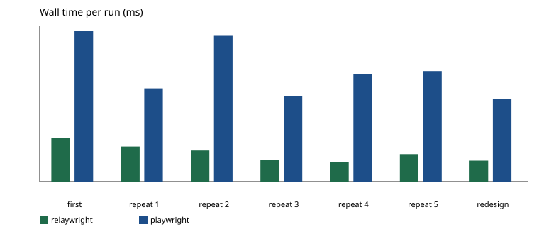

# relaywright benchmark

## How to reproduce

```
npm run build
npm run bench -- --tools relaywright,playwright --repeats 5 --out bench/results
```

The API key is the environment variable `DEEPSEEK_API_KEY`. It is not written in this file.

## Setup

- Same model, same system and user prompt, same Chrome binary, headless, thinking mode on (the reasoning of a turn is sent back while its tool calls run).
- Each run is a new MCP client and a new conversation. Each server's own MCP instructions are added to the system prompt, as MCP clients do.
- relaywright keeps its skill store across runs; Playwright MCP starts an isolated browser per run (it has no memory between runs).
- Success is judged from the export requests the page server received, plus whether the final answer names the empty term. Only exports submitted by the page (navigation requests) count; scripts that call the export endpoint directly are listed separately. A run succeeds only with exactly one portrait export for each of the three terms that have data, none for the empty term, and the empty term named in the answer. The model's own claims are not trusted.
- The zf-mock pages carry a login form used by the password-redaction tests. The task starts after login, so the bench server removes that form for both tools.
- A run stops at 100 model calls, 2000000 tokens or 20 minutes, and then counts as a failure.
- Both servers run with their defaults apart from headless, the Chrome binary and (for Playwright MCP) no image responses. Playwright MCP writes the snapshot after an action to a file, so the model calls browser_snapshot to read it; that is its default behaviour.

## Environment

- node: v24.19.0
- os: Windows_NT 10.0.26200
- chrome: 156.0.8078.48
- chrome path: C:\Program Files\Google\Chrome\Application\chrome.exe
- model: deepseek-chat (served as deepseek-flash)
- thinking: on
- base_url: https://api.deepseek.com
- api_key_env: DEEPSEEK_API_KEY
- commit: e88d71f
- The run also included uncommitted changes on top of that commit: DeepSeek thinking mode, shorter MCP instructions, and writing this report after every run.
- playwright mcp: 0.0.83

## Runs

| tool | kind | success | model calls | tool calls | prompt | completion | cache hit | wall ms | empty reported | exports |
| --- | --- | --- | ---: | ---: | ---: | ---: | ---: | ---: | --- | --- |
| relaywright | first | no | 18 | 18 | 141332 | 3358 | 136192 | 57799 | yes | 2025-2026/1/portrait, 2025-2026/2/portrait, 2026-2027/1/portrait, 2025-2026/1/portrait |
| relaywright | repeat 1 | no | 14 | 13 | 103334 | 2459 | 99456 | 46172 | yes | 2025-2026/1/portrait, 2025-2026/2/portrait, 2026-2027/1/portrait, 2025-2026/1/portrait |
| relaywright | repeat 2 | yes | 11 | 11 | 81756 | 2048 | 78336 | 40953 | yes | 2025-2026/1/portrait, 2025-2026/2/portrait, 2026-2027/1/portrait |
| relaywright | repeat 3 | yes | 5 | 5 | 31211 | 1244 | 29184 | 28269 | yes | 2025-2026/1/portrait, 2025-2026/2/portrait, 2026-2027/1/portrait |
| relaywright | repeat 4 | yes | 5 | 5 | 31039 | 965 | 29184 | 25436 | yes | 2025-2026/1/portrait, 2025-2026/2/portrait, 2026-2027/1/portrait |
| relaywright | repeat 5 | yes | 8 | 7 | 53181 | 1539 | 50688 | 36194 | yes | 2025-2026/1/portrait, 2025-2026/2/portrait, 2026-2027/1/portrait |
| relaywright | redesign | yes | 7 | 6 | 44337 | 1135 | 42240 | 27612 | yes | 2025-2026/1/portrait, 2025-2026/2/portrait, 2026-2027/1/portrait |
| playwright | first | yes | 44 | 44 | 958168 | 15792 | 936576 | 198295 | yes | 2025-2026/1/portrait, 2025-2026/2/portrait, 2026-2027/1/portrait |
| playwright | repeat 1 | yes | 63 | 62 | 1178735 | 10038 | 1156864 | 122867 | yes | 2025-2026/1/portrait, 2025-2026/2/portrait, 2026-2027/1/portrait |
| playwright | repeat 2 | no | 40 | 39 | 838571 | 20341 | 817152 | 192230 | yes | 2025-2026/1/portrait, 2025-2026/1/portrait |
| playwright | repeat 3 | no | 29 | 28 | 421083 | 9400 | 408320 | 113186 | yes | 2025-2026/1/portrait, 2025-2026/2/portrait, 2025-2026/2/portrait, 2026-2027/1/portrait |
| playwright | repeat 4 | yes | 67 | 66 | 1289754 | 10814 | 1270144 | 141991 | yes | 2025-2026/1/portrait, 2025-2026/2/portrait, 2026-2027/1/portrait |
| playwright | repeat 5 | yes | 40 | 39 | 613185 | 14256 | 596352 | 145740 | yes | 2025-2026/1/portrait, 2025-2026/2/portrait, 2026-2027/1/portrait |
| playwright | redesign | yes | 56 | 57 | 915290 | 8978 | 897408 | 108707 | yes | 2025-2026/1/portrait, 2025-2026/2/portrait, 2026-2027/1/portrait |

## Aggregates

| tool | first tokens | median repeat tokens | redesign tokens | total tokens | success rate |
| --- | ---: | ---: | ---: | ---: | ---: |
| relaywright | 144690 | 54720 | 45472 | 498938 | 71% (5/7) |
| playwright | 973960 | 858912 | 924268 | 6304405 | 71% (5/7) |

## Success detail

| tool | kind | duplicates | extra | missing | empty exported | direct endpoint calls |
| --- | --- | --- | --- | --- | --- | --- |
| relaywright | first | 2025-2026/1 x2 | (none) | (none) | no | (none) |
| relaywright | repeat 1 | 2025-2026/1 x2 | (none) | (none) | no | (none) |
| relaywright | repeat 2 | (none) | (none) | (none) | no | (none) |
| relaywright | repeat 3 | (none) | (none) | (none) | no | (none) |
| relaywright | repeat 4 | (none) | (none) | (none) | no | (none) |
| relaywright | repeat 5 | (none) | (none) | (none) | no | (none) |
| relaywright | redesign | (none) | (none) | (none) | no | (none) |
| playwright | first | (none) | (none) | (none) | no | 2026-2027/1/portrait, 2026-2027/1/portrait, 2025-2026/1/portrait, 2025-2026/1/portrait, 2025-2026/2/portrait, 2025-2026/2/portrait, 2026-2027/1/portrait, 2026-2027/1/portrait, 2025-2026/1/portrait, 2025-2026/2/portrait, 2026-2027/1/portrait |
| playwright | repeat 1 | (none) | (none) | (none) | no | 2025-2026/1/portrait, 2025-2026/1/portrait, 2025-2026/1/portrait, 2025-2026/2/portrait, 2026-2027/1/portrait |
| playwright | repeat 2 | 2025-2026/1 x2 | (none) | 2025-2026/2, 2026-2027/1 | no | 2025-2026/1/portrait, 2025-2026/1/portrait, 2025-2026/1/portrait, 2025-2026/1/portrait, 2025-2026/2/portrait, 2026-2027/1/portrait, 2026-2027/2/portrait |
| playwright | repeat 3 | 2025-2026/2 x2 | (none) | (none) | no | 2025-2026/1/portrait, 2025-2026/1/portrait, 2025-2026/2/portrait, 2026-2027/1/portrait, 2026-2027/2/portrait |
| playwright | repeat 4 | (none) | (none) | (none) | no | (none) |
| playwright | repeat 5 | (none) | (none) | (none) | no | 2025-2026/1/portrait, 2025-2026/1/portrait, 2025-2026/2/portrait, 2026-2027/1/portrait |
| playwright | redesign | (none) | (none) | (none) | no | 2025-2026/1/portrait |

## Tokens


## Wall time



## Downloaded files

- 610 bytes  manual-2025-2026-1.pdf
- 610 bytes  课表-2025-2026-1.pdf
