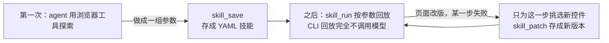
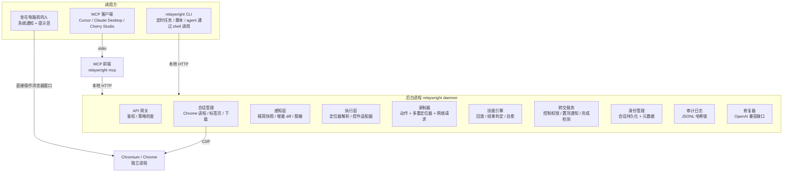

# relaywright 项目介绍

> 版本：0.1.0-rc.2 · 许可证：Apache-2.0 · 语言：TypeScript（Node.js ≥ 22）

**一句话**：AI 学一次浏览器任务，之后自己重复做；遇到登录和验证码，把浏览器交给坐在电脑前的人；凭据全程不进模型，每一步都可审计。

---

## 一、项目背景

### 1.1 现状：AI 浏览器自动化"每次都从零开始"

大模型 agent 已经能操控浏览器完成网页任务（Playwright MCP、Chrome DevTools MCP、browser-use 等），但它们的工作方式是：**每次执行都让模型重新读页面、重新定位控件、重新决策**。对于"每学期导出课表""每天拉取报表"这类高度重复的任务，这带来三个突出问题：

| 问题 | 具体表现 |
|---|---|
| **重复烧 token，成本高** | 同一个任务做十遍，模型要"看"十遍页面，token 消耗是首次的量级 |
| **结果不稳定** | 每次重新决策，同样的页面也可能走出不同的路径，成功率波动 |
| **卡在登录和验证码** | agent 要么失败退出，要么依赖打码平台等灰色手段；密码、cookie 混进模型上下文，安全无法交代 |

### 1.2 我们的答案：探索一次，沉淀成技能

relaywright 让 agent **只探索一次**：



1. **探索一次**：agent 用浏览器工具把任务做成一组参数（比如一个学期的课表）。
2. **沉淀成技能**：`skill_save` 把操作步骤、控件的多重定位方式和结果判定写成一份可读、可改、可提交到仓库的 YAML，个人信息自动换成占位符。
3. **直接回放**：其余参数组合交给 `skill_run`。走 MCP 时 agent 只需调用几次工具；走 CLI 或定时任务时**完全不调用模型**。
4. **只修坏掉的那一步**：页面改版导致某一步失败时，模型只为这一步选出新控件，`skill_patch` 存成新版本，其余步骤不动。

### 1.3 实测效果

同一个模型（DeepSeek）、同一条任务、同一套 Chrome，分别驱动 relaywright 和 Playwright MCP，在仿教务系统页面导出三个有课学期的纵向课表 PDF，并说明哪个学期没课：

| 工具 | 首次 token | 重复中位数 | 改版 token | 合计 | 成功 |
| --- | ---: | ---: | ---: | ---: | ---: |
| relaywright | 144,690 | 54,720 | 45,472 | **498,938** | 5/7 |
| Playwright MCP 0.0.83 | 973,960 | 858,912 | 924,268 | **6,304,405** | 5/7 |

- 重复运行的 token 中位数约为 Playwright MCP 的 **1/16**，页面改版那次约为 **1/20**，总量约为 **1/13**；
- 首次探索也只用约 1/7——因为快照经过精简，动作之后只返回变化的部分；
- 重复运行耗时中位数约 **36 秒**，Playwright MCP 约 142 秒。

---

## 二、技术架构

### 2.1 总体结构：后台进程 + 薄前端



**为什么是"后台进程 + 薄前端"：**

- 浏览器和登录状态需要**常驻**，不能跟着某个 MCP 会话一起结束。后台进程重启时不关闭浏览器，新进程重新连上原来的 Chrome，登录状态不受影响。
- MCP 和 CLI 共享同一个浏览器和会话：在 Cursor 里探索出的技能，可以立刻在终端用 CLI 回放。
- 后台进程只监听 `127.0.0.1`，随机令牌鉴权，不对局域网开放任何端口。
- 不用 Electron：人直接操作真实浏览器窗口，凭据复用 Chrome 自带的密码管理器和系统级加密。

### 2.2 核心模块

| 模块 | 职责 |
|---|---|
| **感知层**（perception） | 基于 `Accessibility.getFullAXTree` + `DOMSnapshot.captureSnapshot` 生成精简快照；`mode="diff"` 只返回相对上一次新增/变化的部分；敏感字段一律输出 `[redacted]` |
| **执行层**（actions） | `browser_act` 支持 click / type / select / press / scroll / upload；**控件适配器**处理"隐藏原生 select + 自定义组件"（chosen、select2、Element UI 等），技能里只保存可见文字或语义值 |
| **录制器**（recorder） | 每次动作记录：动作参数、**多重定位器**（角色+名称、label、文字、CSS、邻近元素相对位置）、前后快照摘要、期间的网络请求 |
| **技能引擎**（skills） | YAML 技能的保存、模板参数替换、确定性回放、`expect` 结果判定、参数矩阵批量执行 |
| **自愈**（healer） | 定位器全部失败时，把失败步骤的 intent + 当前快照交给 LLM 选新 `ref`，验证通过后写成技能新版本；每步最多修 2 次、每次回放最多修 3 步 |
| **转交真人**（handoff） | 控制权锁（同一时间只有一个控制者：agent / skill / human）、浏览器置顶、系统通知、登录完成检测 |
| **身份管理**（identities） | 按域名管理身份；会话 cookie 由 Chrome 用系统加密（DPAPI / 钥匙串 / libsecret）持久化保存 |
| **隐私去标识**（privacy） | 识别"我"的值、带校验的号码（身份证/手机号/银行卡）、敏感字段名；技能出口必去标识 |
| **审计日志**（audit） | 每月一个 JSONL，`hash = sha256(prev_hash + 规范化 JSON)` 形成哈希链，`audit verify` 校验 |

### 2.3 技能文件：可读、可改、可提交仓库的 YAML

```yaml
name: zf-timetable
description: 导出指定学年学期的个人课表 PDF
params:
  year: { type: string, example: 2025-2026 }
  term: { type: string, example: "1" }
steps:
  - id: s1-select-学年
    select:
      target: { role: combobox, name: 学年, css: "#xnm" }
      value: "{{year}}"
  - id: s4-expect
    expect:
      any:
        - outcome: empty
          when: { text_present: 该学年学期尚无您的课表 }
          message: "{{year}} 第 {{term}} 学期尚未排课"
        - outcome: ok
          when: { text_present: "{{year}}学年第{{term}}学期", table_rows_min: 1 }
```

- 每个控件同时记下角色、名称、CSS 和文字，页面小改动时换一种定位方式仍能找到；
- 每行都出现的同名控件**按所在行定位**：`{ role: link, name: 去做题, within: "赛题{{n}}" }`，对 `n` 跑 matrix 就逐行点各自的那一个；
- `expect` 把"尚无课表"这类业务结果判成 `empty`，如实报告，不当成页面坏了去修。

### 2.4 回放引擎与结果判定

单组参数的最终结果只有四种：`ok`（正常完成）、`empty`（声明过的业务空结果）、`needs_human`（需要登录/验证码但无人接管）、`broken`（页面结构变化且自愈失败）。关键约束：**`empty` 永远不触发自愈**——修复器不能"修"出一个不存在的结果。

### 2.5 技术栈与工程

| 用途 | 选型 |
|---|---|
| 语言 / 运行时 | TypeScript，Node.js ≥ 22 |
| 浏览器控制 | `puppeteer-core` + 原始 CDP，`@puppeteer/browsers` |
| MCP | `@modelcontextprotocol/sdk`（26 个工具，参数扁平、返回值短） |
| 后台服务 / CLI | Hono / Commander，参数校验 Zod |
| 修复模型 | OpenAI 兼容接口（默认 DeepSeek），API key 只从环境变量读取 |
| 测试 | Vitest 单元测试 + 浏览器 e2e，同模型对比基准框架（bench） |

代码组织：`src/daemon、session、perception、actions、recorder、skills、healer、privacy、state、audit、mcp、cli`，配 `fixtures/` 仿真页面、`bench/` 对比框架、`examples/` 示例技能，中英文 README 与完整开源治理文件。

---

## 三、应用场景

### 3.1 高频重复的网页任务自动化

凡是"同一套操作、换几个参数反复做"的网页任务，都适合沉淀成技能：

- **教务场景**：每学期导出课表 PDF、批量查成绩、导出培养方案；
- **办公场景**：定时登录内部系统拉取报表、导出订单列表、批量下载对账单；
- **内容场景**：按章节批量下载课件、逐条提交表单、逐行点击列表中每一行的同名按钮。

参数矩阵一条命令批量跑：

```bash
npx relaywright skill run zf-timetable --matrix year=2025-2026,2026-2027 --matrix term=1,2
```

配合 cron / 计划任务，就是**零模型成本**的定时自动化；跨多页的操作还能用状态存储（`state_*`）记住"上次做到哪"。

### 3.2 需要登录的个人账号任务

校内系统、公司内网、个人网银后台——这些都要登录，恰恰是打码平台和企业 RPA 最尴尬的地方。relaywright 把登录交给坐在电脑前的人：扫码、短信验证码、账号密码都在本机完成，会话由 Chrome 加密保存，之后技能自动续跑。**凭据自始至终不进模型。**

### 3.3 作为 agent 的浏览器技能库

- 在 Cursor / Claude Desktop 里，agent 先 `skill_list`：有现成技能就直接 `skill_run`，没有才探索，完成后 `skill_save` 沉淀；
- 技能 YAML 可以提交到团队仓库，同事拉下来配上自己的账号（占位符 `‹我.姓名›` 回放时从回放者自己的身份取值）就能跑；
- 页面改版后自愈产生新版本，`skill history` / `skill rollback` 管理演进，技能像代码一样可版本化。

### 3.4 安全敏感环境的可控自动化

- 域名白名单外的跳转在请求发出前被拦截，放行只来自本机系统对话框（模型不能自己批准）；
- `browser_eval` 默认关闭，日常取数用只读的 `browser_extract`；
- 所有转交、身份操作、脱敏还原、自愈补丁都进哈希链审计日志，`audit verify` 可随时校验完整性，满足合规与追溯要求。

---

## 四、创新点

### 4.1 技能回放：把"试错"变成"资产"

现有浏览器 MCP 的每次执行都是一次性消耗；relaywright 把探索成果固化成**参数化的 YAML 技能**，回放走 CLI 时完全不调用模型。同一任务重复执行的 token 降至业界主流方案的 **1/16**，耗时降至约 1/4——这是本项目最核心的创新，也有完整的同模型对比基准数据支撑（基准框架开源在 `bench/`，成功判定以页面服务器实际收到的请求为准，不采信模型自述）。

### 4.2 多重定位器 + 按行定位：稳，而且准

- 每个控件同时记录角色、名称、文字、CSS、邻近关系等多重定位方式，一条失效换下一条，天然抗小改版；
- 列表中每行都出现的同名控件**锚定所在行的文本**（如"赛题{{n}}"），而不是脆弱的 nth-of-type 序号——列表顺序变化后依然点对各自的行。

### 4.3 单步自愈，而不是整单重跑

页面改版时，只有坏掉的那一步调用 LLM 选新控件，验证通过后存为技能新版本；修好之后的回放重新回到 0 token。同时严格限制修复器的权力：`expect` 没匹配到任何声明结果时只报 `broken`，**不允许模型改判定条件**，避免把真实错误"修"掉。

### 4.4 人是第一等参与者：登录转交真人

区别于"失败退出"或"打码平台"两种极端，relaywright 把转交真人设计成**正常流程**：遇到登录/验证码时锁住模型（所有工具返回 `human_in_control`）、浏览器置顶 + 系统通知，人完成后任务自动继续。伪装成文本框的密码框（如 `placeholder="密码"`）与真密码框同等对待：快照打码、禁止模型输入。

### 4.5 凭据零暴露 + 技能出口去标识

- **模型看不到秘密**：密码、验证码、cookie 不出现在任何工具返回值；会话由 Chrome 自身系统级加密保存，relaywright 不另造加密、不保存任何密码；
- **本机可见，出口必去标识**：本机上模型默认能看到真实内容（否则做不了事），但技能文件作为可分享的产物，保存时自己的值换成 `‹我.姓名›` 占位符、别人的值自动变成参数，并有专门的防泄漏测试扫描所有变体（全角、空格、URL 编码）。

### 4.6 精简快照 + 增量 diff：把页面"读"成本降到最低

快照只保留可交互元素、标题、提示文字和表格摘要；动作之后只返回**变化的行**而非整页。这让"第一次探索"的成本也只有主流方案的约 1/7，连工具定义本身都按"数量少、参数扁平、返回值短"的原则精简到 26 个。

### 4.7 可审计的可信自动化

审计日志按月分文件、逐条哈希链（`sha256(prev_hash + JSON)`），篡改任意一行都会让 `audit verify` 失败；审计中**永远不写**密码、cookie 值和验证码内容。配合域名白名单、系统对话框授权、`browser_eval` 默认关闭，形成一套"默认安全"的完整闭环——这在浏览器 agent 工具里是少见的完整设计。

---

## 附：项目信息

- 仓库：`github:JiangnanZhang-2006/relaywright`
- 快速开始：`npx relaywright init`（Node ≥ 22，本机 Chrome / Edge）
- 文档：`README.md`（中/英）、`docs/architecture.md`（架构设计）、`docs/bench/summary.md`（逐次基准数据）
- 开源治理：Apache-2.0，含 CONTRIBUTING / CODE_OF_CONDUCT / SECURITY / ROADMAP / CHANGELOG
